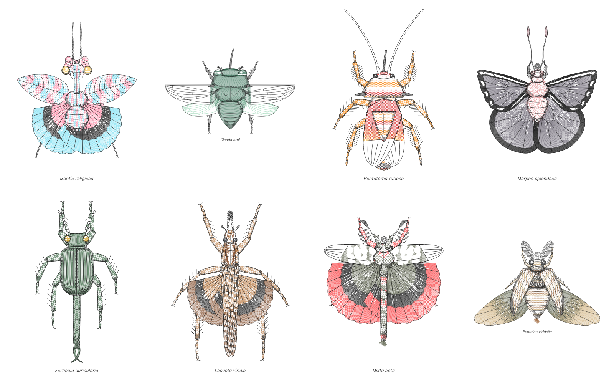

# insectdraw

Procedurally generated, mix-and-match insect drawings for pen plotters.

**Try it:** https://fishertom.github.io/insectdraw/



- 18 body plans (beetle, weevil, earwig, butterfly, moth, dragonfly, lacewing, mayfly, wasp, bee, ant, mantis, stick insect, grasshopper, cicada, shield bug, fly, cockroach) sharing one parts bin of 147 variants across 18 slots.
- A **weirdness** dial (0–1) sets how often each body part is borrowed from a different kind of insect, so surreal combinations happen.
- Top-down "specimen plate" view, drawn entirely as polylines with hidden-line removal, so it's ready to plot.
- Colour comes from coloured pens. The SVG has one Inkscape layer per pen, light colours first and black last, and `vpype read` keeps each pen on its own layer.
- The insect's name is the seed: the same name always gives the same insect.
- A single JavaScript file with no dependencies that runs in Node or the browser.

## In the browser

Open `index.html` (or the GitHub Pages link above). Pick a name or click **New specimen**, adjust the archetype, weirdness, pens, palette, paper and hatch spacing, then click **Save SVG**. The page also shows the equivalent command-line call.

The generator runs in a Web Worker (`worker.js`), so the page has to be served over HTTP; GitHub Pages does that. To try it locally:

```
python3 -m http.server   # then open http://localhost:8000
```

## Command line

```
node insectdraw.js --seed "Helio somnensis" > helio.svg
node insectdraw.js --seed "Mantis religiosa" --arch mantis --weird 0.6 --pens 3 --palette forest --paper a3 > mantis.svg
node insectdraw.js --help
```

| Option | Meaning |
| --- | --- |
| `--seed "Genus species"` | name and seed (random if omitted) |
| `--arch` | beetle, weevil, earwig, butterfly, moth, dragonfly, lacewing, mayfly, wasp, bee, ant, mantis, stick, grasshopper, cicada, shieldbug, fly, cockroach |
| `--weird 0..1` | 0 = true to type, 1 = every part from the full parts bin |
| `--pens 1\|2\|3` | colour pens, plus black |
| `--palette` | ladybird, jewel, monarch, morpho, moth, dragonfly, lacewing, wasp, orchid, tropical, rust, sunset, ocean, forest, neon, bronze, plum, candy, arctic, desert, berry |
| `--paper` | a5, a4, a3, letter, square (orientation is automatic, or `--orient portrait\|landscape`) |
| `--spacing mm` | hatch spacing on paper (default 0.55) |
| `--format svg\|json` | `--no-label`, `--no-sort` |

## As a library

```html
<script src="insectdraw.js"></script>
<script>
  const R = insectdraw.generate({seed: 'Helio somnensis', weird: 0.5, paper: 'a4'});
  document.body.innerHTML = insectdraw.toSVG(R);   // or use R.strokes: [{pen, pts: [[x, y], ...]}] in mm
</script>
```

In Node: `const {generate, toSVG} = require('./insectdraw.js')`.

## Plotting

Each pen is an Inkscape layer, so a typical vpype pipeline plots one pen at a time:

```
vpype read helio.svg linesort write --page-size a4 helio_sorted.svg
```

## How it works

Each insect is assembled from independent slots (head, eyes, mouthparts, horns, antennae, pronotum, thorax, waist, abdomen, forewings, hindwings, leg style, front legs, hind legs, tail, texture, body pattern and wing pattern). Parts are added front to back, and each new part's strokes are clipped against the silhouettes already drawn; that's the hidden-line removal trick from fishdraw. Colour patterns are functions from a point to a pen, which cut the hatch lines into per-pen runs. Wing venation uses Voronoi cells, eyes use hexagonal facets, and the textures include flow fields, contour rings, fish scales and stipple. The drawing is built twice: the first pass measures it, and the second sets the hatch spacing so it comes out constant in millimetres on the paper.

## Credits

Inspired by [fishdraw](https://github.com/LingDong-/fishdraw) by Lingdong Huang (MIT). The Hershey single-stroke font data comes from fishdraw; the Hershey fonts themselves are public domain.
